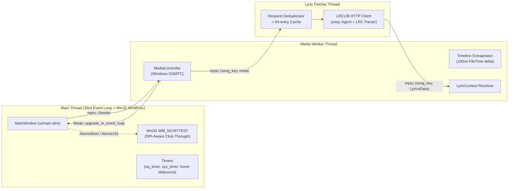

# System Architecture Overview

Fidra Island uses a **3-thread event-driven architecture** to keep the Slint UI strictly responsive (`60fps+` animations, zero freezes) while interacting with blocking Windows WinRT APIs and remote HTTP lyrics endpoints.

## High-Level Threading & Data Flow

## Layer Responsibilities

### 1. Presentation Layer (`ui/main.slint`)
- Fixed `680px x 220px` logical transparent root `Window` (`no-frame: true`, `always-on-top: true`).
- Unified morphing wrapper (`island-wrapper`) combining the obsidian `island` body and synchronized left/right tangential ear flares (`14px` each).
- Persistent Compact and Expanded layers controlled via opacity and layout animations.
- Emits user intents via Slint callbacks (`toggle-playback`, `skip-next`, `skip-previous`, `seek`, `seek-to-lyric`, `toggle-lyrics`, `toggle-pinned`, `toggle-expanded`, `hover-changed`).

### 2. Application, Config, Logging & Platform Layer (`src/app.rs`, `src/config.rs`, `src/logging.rs`, `src/platform/`)
- `src/main.rs` is a thin entrypoint delegating to `app::run()`.
- `src/app.rs` owns the Slint event loop, UI timers, zero-CPU blocking tray action dispatcher, and thread-safe bridges (`mpsc` channels, `Arc<Mutex<LyricContext>>`, atomics).
- `src/config.rs` atomically loads/saves user preferences (`lyrics_enabled`, `is_pinned`, `launch_at_startup`) in `%APPDATA%\FidraIsland\config.json`.
- `src/logging.rs` writes UTC structured logs with `2 MiB` rotation under `%LOCALAPPDATA%\FidraIsland\logs\fidra-island.log`.
- `src/platform/` (`windows.rs` + cross-platform `stub.rs`) encapsulates Win32 overlay centering, panic-safe DPI-aware `WM_NCHITTEST`, `WM_DISPLAYCHANGE`/`WM_DPICHANGED` re-centering, native System Tray (`Shell_NotifyIconW`), Registry auto-start, and RAII `ComGuard` MTA initialization.
- Enforces **Zero-CPU Idle**: `eq_timer` runs only while `is_playing == true`; `sys_timer` refreshes every `5s` and mutates Slint properties only when minute/battery values change; the tray dispatcher blocks in `recv()` with `0%` CPU.
- Signals graceful shutdown to worker threads via `Arc<AtomicBool>` and removes the tray icon (`NIM_DELETE`) when the event loop exits.

### 3. Media Integration & Color Extraction Layer (`src/media.rs`, `src/media/`)
- Polls Windows `GlobalSystemMediaTransportControlsSessionManager` on a dedicated background thread (`250ms` cadence when playing, `1000ms` "doze off" when paused).
- Extrapolates smooth playback progress using GSMTC `LastUpdatedTime` (`100ns` ticks) and monotonic `Instant` anchors, avoiding timeline jitter during seek operations.
- Emits album artwork as incremental [`ThumbnailUpdate`](../../src/media.rs) deltas (`Unchanged | Cleared | Updated(Vec<u8>)`) so artwork is decoded only on track change.
- Analyzes thumbnail bytes on song change to extract the primary vibrant ambient color (`R, G, B`), feeding Slint's dynamic ambient lighting glow.
- Dispatches transport commands (`TryTogglePlayPauseAsync`, `TrySkipNextAsync`, `TrySkipPreviousAsync`, `TryChangePlaybackPositionAsync`) without blocking on WinRT futures.

### 4. Lyrics Pipeline (`src/lyrics/`)
- Subdivided into modular domain units (`mod.rs`, `parser.rs`, `cache.rs`, `client.rs`), each well under 250 LOC.
- Runs on an isolated worker thread so network latency never stalls playback polling.
- Drains queued requests on rapid track skipping so only the latest track is fetched.
- Persistent disk cache in `%LOCALAPPDATA%\FidraIsland\cache\lyrics\` with 14-day positive / 2-day negative TTL.

### 5. Multi-Widget Companion Pipeline (Roadmap)
- Extensible state architecture accommodating:
  - `Hydration`: Interval timer triggering a temporary 6-8s dynamic island droplet banner pulse and updating the daily habit ring.
  - `Prayer Times`: Offline astronomical solar altitude calculation (Kemenag standard) feeding compact pill countdown and adhan alert pop-up.
  - `Task Checklist`: Compact to-do list with persistent local storage.
- Sanitizes noisy track titles/artists via pre-compiled `OnceLock<Regex>` rules.
- Queries LRCLIB `/api/get` (exact match with duration) and falls back to `/api/search` (preferring candidates within `±5s` of track duration) over a shared `OnceLock<ureq::Agent>`.
- Parses standard LRC (`[mm:ss.xx]`), `[offset:+/-ms]`, and enhanced word-synced LRC (`<mm:ss.xx>`), stripping inline tags from display text.
